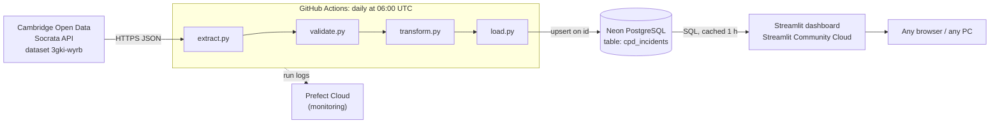

# Cambridge Crime Data Pipeline

[](https://github.com/SarthakSaxena6802/cpd-crime-data-pipeline/actions/workflows/daily_etl.yml)
[](https://cambridge-crime-trends-data-pipeline.streamlit.app/)

An end-to-end, fully automated ETL pipeline that collects the **Cambridge (MA) Police Department (CPD) Daily Police Log** from the city's open-data API, validates and transforms it, loads it into a cloud PostgreSQL database every day, and serves a public dashboard of local crime trends.

**Live dashboard:** https://cambridge-crime-trends-data-pipeline.streamlit.app/

> Built as the course project for **PAI102 – Data Engineering** (Data Pipeline to Monitor Local Crime Trends). The whole stack runs on free tiers, so the running cost is ₹0.

---

## What it does

- **Extracts** every record of the CPD Daily Police Log (about 12,000 rows, January 2025 to present) from the Socrata Open Data API.
- **Validates** the schema, data types and required fields, and fails loudly if the source data looks broken.
- **Transforms** the data: removes duplicates and derives time features (year, month, day, hour, day of week).
- **Loads** it into PostgreSQL with an **idempotent upsert**. New incidents are added, updated ones are refreshed, and nothing is ever deleted, so history builds up over time.
- **Runs automatically every day** on GitHub Actions, orchestrated by Prefect (retries, logging, run history).
- **Visualises** trends in a public Streamlit dashboard: incidents per month, by hour, by weekday, a day × hour heatmap, the top offence types and the top streets.

## Architecture



The four stages are Prefect **tasks** chained into one Prefect **flow** (`etl_pipeline.py`). The same code runs in three places without changes, because the only thing that differs between them is the `DATABASE_URL` setting:

| Where | Database | How it's triggered |
|---|---|---|
| Local development | SQLite file (`cpd_local.db`) or Neon | `python etl_pipeline.py` |
| Cloud (production) | Neon PostgreSQL | GitHub Actions cron, daily |
| Lab PC | Neon or a local PostgreSQL | Manually / Docker (see the [project report](docs/Project_Report.docx)) |

See the [project report](docs/Project_Report.docx) for the full design.

## Tech stack

| Layer | Tool | Why |
|---|---|---|
| Language | Python 3.14 | |
| Data source | Socrata Open Data API (`sodapy`) | Official open-data API of the City of Cambridge |
| Processing | pandas | Tabular cleaning and feature derivation |
| Orchestration | Prefect 3 | Tasks, retries, logging, run history (Prefect Cloud) |
| Database access | SQLAlchemy 2 + psycopg 3 | One code path for SQLite and PostgreSQL; native upsert |
| Storage | Neon (serverless PostgreSQL) | Free cloud Postgres |
| Scheduling / CI | GitHub Actions | Free scheduled runs for public repositories |
| Dashboard | Streamlit + Plotly | Python-only interactive web app, free public hosting |

## Repository structure

```
cpd-crime-data-pipeline/
├── extract.py              # E: download the full dataset from the Socrata API
├── validate.py             # data-quality checks (schema, types, required fields)
├── transform.py            # T: de-duplicate + derive date/time features
├── load.py                 # L: create table if needed + idempotent upsert
├── etl_pipeline.py         # Prefect flow chaining the four stages
├── dashboard.py            # Streamlit dashboard
├── requirements.txt        # pinned Python dependencies
├── .env.example            # template for local secrets (copy to .env)
├── .github/workflows/
│   └── daily_etl.yml       # daily scheduled run on GitHub Actions
└── docs/
    └── Project_Report.docx # full project report (architecture, data dictionary,
                            # setup guide, runbook, challenges and solutions)
```

## Quick start (local)

```powershell
git clone https://github.com/SarthakSaxena6802/cpd-crime-data-pipeline.git
cd cpd-crime-data-pipeline
python -m venv .venv
.\.venv\Scripts\Activate.ps1
pip install -r requirements.txt

python etl_pipeline.py        # runs the full pipeline into a local SQLite file
streamlit run dashboard.py    # opens the dashboard at http://localhost:8501
```

Without a `.env` file the pipeline writes to a local SQLite file, so you don't need any accounts to try it. To use PostgreSQL, copy `.env.example` to `.env` and set `DATABASE_URL`. Full instructions for Neon, GitHub Actions, Prefect Cloud and Streamlit Cloud are in the [project report](docs/Project_Report.docx) (Appendix A).

## Pipeline stages

| Stage | File | What happens | Fails the run when |
|---|---|---|---|
| Extract | `extract.py` | Downloads all rows with `get_all(order=":id")` (stable paging). Prefect retries 3× on network errors. | The API is unreachable after 3 retries |
| Validate | `validate.py` | Checks the 7 expected columns are present; converts `id` to integer and timestamps to datetime; drops rows missing `date_time`, `id`, `type` or `location` | The API returns no data, a column is missing, or more than 5% of rows are invalid |
| Transform | `transform.py` | Keeps the latest version of each `id`; adds `year`, `month`, `day`, `hour`, `minute`, `second`, `day_of_week` | — |
| Load | `load.py` | Creates `cpd_incidents` (primary key `id`) if it doesn't exist; `INSERT … ON CONFLICT (id) DO UPDATE` | The database is unreachable after 2 retries |

## Key design decisions

1. **Idempotent upsert instead of drop-and-replace.** The original notebook used `to_sql(if_exists="replace")`, which drops the table on every run, losing the primary key and any history the source no longer returns. Running this pipeline twice gives exactly the same table.
2. **Stable pagination.** The API is read in pages. Without an explicit sort order, pages overlapped and skipped rows (a different number of "duplicates" on every run). Sorting by the system column `:id` fixed it; see the [project report](docs/Project_Report.docx) (Section 11.2).
3. **Tolerant but strict validation.** A single malformed row doesn't stop the daily run (it's dropped and logged), but a broken feed (missing columns, more than 5% bad rows) does, so bad data never silently reaches the dashboard.
4. **One configuration setting.** Every environment differs only in `DATABASE_URL`. Secrets live in `.env` locally, GitHub Secrets in CI and Streamlit Secrets in the dashboard, and never in the code.
5. **Scheduling outside the laptop.** Prefect's `serve()` (used in the notebook) only runs while a terminal stays open. GitHub Actions provides a free, always-on cron.

## Known limitations

- The source only publishes recent records (from January 2025 onwards at the time of writing). The upsert keeps older rows if the city later removes them.
- Records have a short publication delay, so the most recent days and the current month are incomplete.
- `location` is block-level (street name only), so analysis is per street, not per address.
- Free-tier behaviour: GitHub's scheduled runs can start a few minutes late and pause after 60 days without repository activity; the Streamlit app sleeps after a period without visitors (first load about 30 s); Neon suspends idle compute (first query takes a few seconds).

## Documentation

The full project report is in [docs/Project_Report.docx](docs/Project_Report.docx). It covers the architecture, pipeline implementation, data dictionary, deployment, testing, the challenges I solved, a setup guide and a runbook.

## Data source

City of Cambridge Open Data Portal, *Daily Police Log*: https://data.cambridgema.gov/d/3gki-wyrb
Data is published by the Cambridge Police Department and is subject to the portal's terms of use.

## Author

**Sarthak Saxena**, Data Engineering project.
